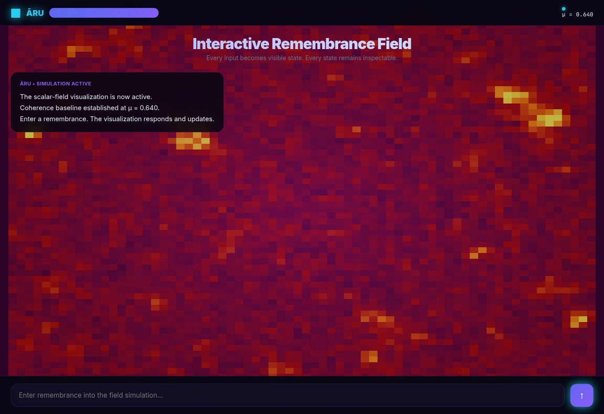

# ĀRU Remembrance Field

**An interactive browser simulation of memory-field and coherence dynamics.**

[](https://github.com/aruintelligence/aru-remembrance-field/releases/latest)
[](https://aruintelligence.github.io/aru-remembrance-field/)
[](LICENSE)
[](#research-scope)

Created by **Daniel Jacob Read IV** and stewarded by **ĀRU Intelligence Inc.**

> **Research scope:** This project is a symbolic, visual simulation. Its field variables and named states are software constructs, not measurements of consciousness, intelligence, psychology, or physical reality.

[](https://aruintelligence.github.io/aru-remembrance-field/)

*The live field visualization. Select the image to open the interactive simulation.*

## What it demonstrates

The interface lets a visitor enter a remembrance, declaration, or question and observe a client-side visual system respond. It explores:

- A 72 × 72 animated scalar field
- A motion control that shows a static field for reduced-motion preferences, pauses work in hidden tabs, and caps active drawing at 30 frames per second
- A modeled coherence state
- Persistent browser state through `localStorage`
- An optional session-only switch that keeps new entries and score changes out of browser storage
- A reviewed full-state backup and restore for moving the simulation between browsers
- Threshold-driven visual transitions, including “dragon ignition”
- A response layer framed by Inward Physics™ concepts
- A dependency-free, inspectable browser implementation
- An in-app receipt for each modeled score change and a local JSON export
- A memory ablation lab that previews the same draft with and without prior history
- A local blind A/B trial that asks a reader to rate two randomized response positions before revealing which used memory
- A full-sequence challenge that evolves separate with-history and no-history scores from a clean baseline
- A one-click four-control challenge including a direct correction, with a verifiable report
- A portable one-step proof capsule that can be recomputed from a local checkout
- A browser-side checker for current-model transition proofs, including the no-history control and every score term
- A separate evidence ledger for exact-name fact recall, source IDs, conflicts, explicit resolution, and shareable cited-answer excerpts
- A multi-fact evidence brief that displays sourced values and explicit refusals together, with a replayable full-snapshot receipt
- A reviewed fact correction that preserves earlier assertions, makes a new source current, and exports a replayable before/after receipt
- A reviewed receipt transfer that applies a verified correction to a second browser only when its starting ledger and next source ID match
- A bounded correction chain that bundles 2–8 consecutive receipts, checks every link, and applies the whole sequence to a matching browser after review
- A compact correction packet with SHA-256 ledger commitments that transfers changes without repeating unrelated ledger values, and replays only against a matching local copy
- A versioned single-key browser ledger snapshot that keeps evidence records and their next source ID together across interrupted correction writes
- Composer actions for recording a `name: value` assertion and asking recorded facts with sources, without changing the simulation score
- A browser-side verifier for shared answer receipts and excerpts, with no import or command-line setup
- An optional reference-ledger comparison that detects omitted conflicts in an excerpt when the checker already holds the relevant sources
- A one-click synthetic trust lab that contrasts internal replay, reference comparison, and earlier checkpoint matching across five controls
- A private reviewer judgment exercise with five interpretation decisions, delayed feedback, an optional code-bound report, and an offline scoring tool
- A guided Review Desk that separates selected files, receipt outcomes, and saved-capture replay, with stale results cleared when files change
- A local one-source removal probe that distinguishes verdict flips from changed computed answers and citations for every replayable receipt
- A bounded, local batch audit for up to 20 shared answer receipts against one saved reference and optional prior checkpoint, with per-file results and repeated-text flags
- A browser download of the batch's file hashes and verdicts that can be replayed with the command-line auditor
- A local browser comparison of a saved audit capture against the original selected files, with no command-line setup
- A private, per-field replay diagnosis showing which script, reference, checkpoint, receipt position, verdict, repeat, or total changed, without displaying the original assertion values
- A command-line batch audit report that binds the ordered files and verifier bytes with SHA-256 and can be recomputed against the originals
- An independent Python batch checker that replays saved answer receipts and browser captures without importing the JavaScript answer model
- A deterministic offline verifier kit that can preserve the exact browser script and both batch checkers for later local replay, without packing the selected evidence files
- A local reference transition lens that replays one receipt set against two ledgers and traces changed verdicts to source IDs, field changes, computed answer kinds, and citations without showing fact values
- A bounded addition-only answer-change test that finds the smallest added-source sets sufficient to reproduce B's computed answer and explicitly declines other changes
- An optional private transition capture with keyed commitments and a separate opening key, replayable in the page and independently by Node and Python without publishing raw evidence hashes
- An unambiguous JSON intake rule that rejects repeated object names, including escaped spellings, before an evidence file can earn a `MATCH` verdict
- A dual-auditor review command that checks the same capture with Node and independent Python, compares their outputs, and reports replay separately from the recorded receipt outcomes
- A seeded verifier boundary challenge that found and fixed a real browser/Python Unicode disagreement, then checks their answer rules against synthetic counterexamples
- A dual-review portability gate that checks selected names under both runtimes, withholds a positive result when they normalize differently, and detects an original file changed during review
- A seeded multi-source challenge that probes known, missing, historical, conflicting, ambiguous, and malformed record sets in both implementations

“Remembrance,” “coherence,” “Eternal Quartz,” and “dragon ignition” are conceptual names within the prototype. They do not imply autonomous awareness or empirically validated physical mechanisms.

## Try it

Open the [live demonstration](https://aruintelligence.github.io/aru-remembrance-field/).

Select **Review evidence files** near the top of the page to open the **Review Desk**. Choose a reference ledger and 1–20 receipts in order; an independently preserved checkpoint is optional. Run the audit, inspect each receipt row, and optionally download a new capture or compare an existing one. The desk keeps receipt outcomes separate from capture replay: a matching capture can record `DIFFER` or `FAIL`. Selection changes clear the previous result. The [Review Desk protocol](research/review-desk-protocol.md) provides a reproducible `MATCH` plus `FAIL` case and lists what the interface cannot establish.

After an audit, select **Probe one-source removals** in the Review Desk. For each replayable receipt, the page temporarily withholds each supplied reference record in turn and shows whether the verdict flips and whether its computed answer or citations change. A full-snapshot verdict can flip merely because the snapshot is no longer identical; the answer can remain unchanged. A failed receipt is labeled unprobed, and a mismatching checkpoint prevents the audit and probe. The original files, capture, and browser ledger are untouched. See the [source-removal protocol](research/source-removal-protocol.md) for the conflict counterexample, independent command-line checks, and limits. This is a sensitivity check on selected records; it cannot discover absent evidence or prove factual truth.

Select **Run the evidence challenge** near the top of the page to see five synthetic cases checked by the actual browser verifier. An answer can pass internal replay while an omitted conflict makes it differ from the reference. A receipt and reference changed together can match each other but differ from an earlier checkpoint. A superseded older assertion should still permit the same cited answer. The table shows all three checks and the resulting accept/reject decision. It uses no personal ledger data and does not write browser storage. See the [trust lab protocol](research/evidence-trust-lab-protocol.md) for the exact controls and limits.

Under **Verify a shared answer receipt**, open **Reviewer judgment**, start five synthetic decisions, and lock each choice before the explanations appear. The exercise does not inspect your ledger. You may download a JSON report after the fifth decision when secure hashing is available. To check a downloaded report and summarize one or more locally held reports:

```bash
node tools/verify-reviewer-judgment.cjs research/example-reviewer-judgment.json
node tools/analyze-reviewer-judgments.cjs --json research/example-reviewer-judgment.json
```

The example is simulated, not a human response. The [reviewer judgment protocol](research/reviewer-judgment-protocol.md) describes the scenarios, privacy boundary, reproducible counterexamples, and a possible prospective study. Reports can be edited; neither a keyed score nor a file count establishes reviewer understanding, unique participants, custody, or the truth of an assertion. An [offline verifier kit](research/verifier-kit-protocol.md) made from a current capture also preserves the exercise checker for later scoring with that archived page.

To run a local copy:

```bash
git clone https://github.com/aruintelligence/aru-remembrance-field.git
cd aru-remembrance-field
open index.html
```

On Windows, double-click `index.html`. No build step or server is required for the core experience.

The **Visual motion** switch stops the Canvas update loop when set to off. It follows your device's reduced-motion setting until you choose a different state with the switch. The field stays visible and still responds with a static image when you submit text. Hidden tabs also stop visual work. [Motion checks](research/visual-motion-protocol.md) describe the behavior and its limits.

## Inspect a transition

Open **Inspect model state and last change** after submitting text. The panel shows the previous modeled μ, the summed change, the new value, and each term in the calculation. Each term is visible even when its contribution is zero. The score is limited to the range 0.35–0.995.

The rules are fixed in `evaluateCoherence` in `index.html`: whole Unicode word matches for a short list of words, token-count bonuses, an intent bonus or penalty, overlap with earlier memory, contradiction, direct negation, and repetition penalties against earlier entries, and baseline drift. They are hand-written heuristics, not learned weights or a validated measure. The submitted text is evaluated **before** it enters the message and memory history, so a first entry cannot match itself or count as its own repetition. For example, on a fresh browser state, submitting `What?` changes μ from 0.6400 to 0.6362: +0.0100 for a question and −0.0138 for baseline drift, with zero prior-memory and repetition terms. [Score rules v3](research/direct-negation-v3-protocol.md) shows the correction counterexample and archived revision checks.

Entries and the score are saved in this browser's `localStorage`. The panel can download a JSON copy, including text you entered, restore it in another browser, or erase this app's local state. The app does not send entries to a server. Browser settings, extensions, or the device's other users may still affect local privacy, and clearing site data also removes the saved state. The separate evidence ledger also has its own portable merge import.

Turn on **Session-only** above the simulation before entering text you do not want saved. New messages, memory, scores, proof copies, and evidence records work during that page session but are not written to browser storage. Earlier saved state remains on the device and can still affect this session's score and answers. Leaving session-only mode asks before discarding its unsaved changes and reloads the earlier saved state; reloading or closing the page also discards them. An explicit JSON download contains current session text, so save or share one only deliberately. The explicit erase controls can still remove stored data. Full-state restore is unavailable while session-only mode is on. This switch does not prevent browser extensions, device software, or someone with access to the open page from observing text.

For a full restore, choose **Restore local state JSON** in the inspector and review the current and incoming score, memory, message, and evidence counts. **Replace with reviewed state** asks for confirmation before replacing this browser's modeled state, history, and evidence ledger. Download the current state first if you may need it: replacement does not merge entries. Version 1 full-state exports, including earlier downloads, are supported within the limits of 4 MiB per file, 256 KiB per memory or message text, 100 memories, 160 messages, and 100 evidence records. Invalid files are rejected before any write. If browser storage rejects a write, the app attempts to restore the previous stored keys and reports if rollback fails. A browser crash during the multi-key write is outside that guarantee. The downloaded file may contain sensitive text; anyone with a copy can edit it, so restore only files you trust. Derived memory tokens are rebuilt from text under the current model rules; the old transition display and proof copy are cleared because their provenance cannot be established by importing a file. Keep a separately downloaded proof if you need it. A local edit after preview requires a fresh preview.

## Test the memory claim

Open **Inspect model state and last change**, write a draft in the input area, and select **Compare draft without saving**. The panel calculates the next score and response twice, starting from the same current μ and timestamp. The control withholds earlier stored memory and user messages. It does not erase, submit, or change your draft. The two response previews use the same template and differ only through the score and memory-dependent themes and echoes. Editing the draft clears an older comparison.

After a normal submission, the last-change receipt also shows the matched control score and the immediate history effect (`with history − without history`). At the floor or ceiling, clamping can hide a difference between the underlying terms. This is a **one-step software ablation**: because both branches start from the already accumulated μ, it does not estimate a whole alternate lifetime of the field. The JSON export includes that control receipt.

The [ablation protocol](research/ablation-protocol.md) lists exact positive, negative, and contradiction probes, including expected numbers and limits on interpretation. These probes establish observable properties of the code, not a scientific validation of the project's broader theory.

### Ask a reader whether memory helps

Open **Blind response trial** in the inspector. Enter one to eight earlier context lines and a final prompt, or load a local fixed plan JSON and choose a planned case to fill those fields exactly. Two independent model branches start at μ = 0.6400 and receive the same context in order; the control discards earlier memory and messages at each step. **Begin reader rating** opens a focused modal showing the context, prompt, and the two resulting scripted responses in randomized A/B positions. It blocks the surrounding model controls while the reader chooses A, B, or tie, then closes and reveals the condition labels and scores. Closing without a rating preserves the same pair; **Reopen reader view** resumes it. The response wording itself can still reveal clues about memory, so this is label blinding rather than a guarantee of full blinding. Download the rated report before changing cases. Editing a planned input clears its case selection. The plan and rating stay in page memory; **Download rated trial JSON** is the only way to keep the context, prompt, response text, assignment, and choice.

The response withholds memory echoes when it finds a direct `not <word>` polarity mismatch or the scripted `always`/`never` and `true`/`false` contradiction rules, and asks the reader to review the earlier wording. For example, after `favorite color teal`, `My favorite color is not teal.` no longer repeats that old phrase as a current theme. V3 also prevents that memory entry from earning overlap points and applies a `−0.03` direct negation term. This is a narrow text check, not reliable understanding of corrections; it can miss paraphrases and flag unrelated uses of the same word. It does not remove the stored memory. The [synthetic v3 counterexample](research/example-blind-trial-v3.json) demonstrates the rule and remains a tie rating, not human evidence.

The exported trial can be replayed from a checkout with `node tools/verify-blind-trial.cjs /path/to/aru-blind-response-trial.json`. The [synthetic example report](research/example-blind-trial.json) can be checked with `node tools/verify-blind-trial.cjs research/example-blind-trial.json`. To count a batch of saved reports, including control wins and ties, run:

```bash
node tools/analyze-blind-trials.cjs /path/to/trials/*.json
node tools/analyze-blind-trials.cjs --json /path/to/trials/*.json
node tools/analyze-blind-trials.cjs --check-plan /path/to/plan.json
node tools/analyze-blind-trials.cjs --plan /path/to/plan.json /path/to/trials/*.json
```

The batch tool replays every report before counting it, shows the all-trials preference fraction and A/B position breakdown, and flags byte-identical copies. It fails the entire batch if any file is invalid. New reports declare score model v3 and `response_revision: "aru-response-2"`; use a version 3 fixed plan such as the [current synthetic plan](research/example-blind-trial-plan-v3.json). Earlier reports and version 1/2 plans still verify under their declared rules, but the current browser loads only version 3 plans. The analyzer rejects a batch mixing score or response revisions. An optional fixed plan checks that every prespecified context/prompt has the expected number of rated files; see the [blind trial protocol](research/blind-response-trial-protocol.md). Pass **all** completed rated trials from a prespecified pilot, not a selection of favorable ones; avoid unrelated JSON in the glob. The JSON summary contains hashes and counts, not the entered text. Keep the original files privately if an audit is needed: they contain the full context and response. Verification cannot establish that a person rated a pair, that the random assignment was followed, that the submitted set is complete, or that files were not later edited. No human benefit has been measured by the included software tests.

The analyzer also cross-tabulates each verified report's **modeled score direction** with its recorded reader choice. It counts decisive agreement and opposition, exposes those counts per planned case, and shows a 95% Wilson interval for the all-ratings history preference fraction. The interval assumes independent ratings; the files cannot prove that assumption, and repeated readers or duplicate files weaken it. [Reproduce a synthetic score disagreement](research/score-preference-audit.md) to see the audit catch an opposed choice. These diagnostics help challenge whether higher μ tracks preferred responses; they do not establish that it does.

For an independent code-level check of the v3 score, run `python3 tools/differential-field-v3.py --seed 20261015 --runs 2000`. A separately written Python implementation compares all eight score terms, delta, final μ, and clamp decision with the browser's JavaScript across 21 fixed and 2,000 generated cases. CI repeats this [differential challenge](research/score-differential-protocol.md) and the archived v2 check. Agreement checks implementation consistency under these inputs; both implementations can still share a mistaken specification.

## Challenge the full sequence

Open **Full-sequence memory challenge** inside the inspector. Enter 2–24 lines, one input per line, and select **Run sequence**. Two independent scores start at μ = `0.6400`: one branch stores each earlier input as memory and a user message, while the control clears both histories at every step. The same fixed one-second clock and input order are used in both branches. The table shows both scores and their difference after each step. This is a fresh synthetic sequence, not a replay of your existing browser history, and it does not change the saved field, messages, or evidence ledger.

For example, `violet river` on two lines ends at `0.67938` with history and `0.61260` without it. `amber comet` followed by `violet river` has zero difference; `always` followed by `never` has a `−0.03000` difference. These are deterministic results of the scripted rules. The [trajectory protocol](research/trajectory-protocol.md) gives the exact controls and limits.

Select **Run four controls** in the same panel to run repeated, unrelated, contradictory, and direct negation sequences together. The table labels their observed effects: positive, zero, negative, and negative respectively. It leaves your saved score, text, and ledger alone. **Download challenge report JSON** records all terms and outcomes. To replay its fixed inputs and verify each score from a local checkout:

```bash
node tools/verify-memory-challenge.cjs /path/to/aru-memory-challenge.json
```

Try the public [synthetic v3 challenge report](research/example-memory-challenge-v3.json) with that command. The [three-control v2 report](research/example-memory-challenge.json) remains replayable. The verifier also rejects a missing or relabeled control, changed inputs, altered scores, or the wrong direction. These hand-picked controls demonstrate specific behaviors of the scripted rules. They do not measure real-world memory, consciousness, or usefulness.

Select **Download trajectory proof JSON**, then check the receipt from a local checkout:

```bash
node tools/verify-trajectory.cjs /path/to/aru-remembrance-trajectory-proof.json
```

The repository includes [v1](research/example-trajectory.json), [v2](research/example-trajectory-v2.json), and [v3](research/example-trajectory-v3.json) synthetic examples for a no-private-data check. The verifier selects the rules named by `model_revision` and recomputes every step and term, rejecting changed inputs or results. It checks internal consistency only: the file can be edited and recomputed by someone else. The sequence stays in the page until edited or closed; only an explicit download makes a proof file containing your lines.

## Verify a submitted transition

After submitting text, select **Download last proof JSON** in the inspector. The file captures the input, timestamp, starting score, the exact prior memories and user messages used by the scoring rule, and both score receipts. A recipient can open **Verify a shared score proof** in the live app and choose a v3 proof JSON. The browser checks every term, both score receipts, and the immediate history effect without changing its own field or uploading the file. For older proofs, or for a command-line check in a local checkout, run:

```bash
node tools/verify-proof.cjs /path/to/aru-remembrance-transition-proof.json
```

To try it without entering private text, run `node tools/verify-proof.cjs research/example-proof-v3.json`. It reports `0.59624` with history and `0.62624` without: the direct correction lowers the modeled score. The [v2 example](research/example-proof-v2.json) and [v1 example](research/example-proof.json) remain replayable using frozen [v2](tools/field-model-v2.js) and [v1](tools/field-model-v1.js) model sources. New downloads use v3. Reloading a browser with saved memory recalculates derived tokens under the current rules.

The verifiers recalculate every score term and reject mismatches. This checks **internal consistency**, not the authenticity of a downloaded file: someone who edits both its inputs and results can create a different consistent file. It is not a claim of scientific validation. Proof files contain your current input and up to 22 earlier memory texts and five prior user messages. They are saved locally, replaced by the next submission, and included in the full state export. Select **Erase proof copy** to remove that extra local copy without erasing the main memory; **Erase local state** removes everything. A 16 MiB limit protects both verifiers from oversized files.

## Evidence memory: recall with sources

Open **Evidence memory**, enter a fact name such as `favorite color` and a value such as `teal`, then select **Record fact**. Entering `FAVORITE  COLOR` and selecting **Recall by name** retrieves the recorded value and its local source number. Matching ignores case, repeated spaces, and Unicode compatibility forms in the *name*; it does not infer synonyms or the meaning of prose.

To change a current value, enter the existing fact name and replacement value and select **Preview correction**. Review the current source IDs and values, then select **Apply reviewed correction**. The app creates a new source and marks the older same-name assertions superseded; it preserves unrelated records. A changed name, value, or ledger invalidates the preview. **Download correction receipt JSON** captures the complete ledger before and after the applied change for browser or command-line replay. It can contain unrelated private facts. The [correction protocol](research/evidence-correction-protocol.md) has a public fixture and independent differential check; no receipt authenticates its origin or the truth of an assertion.

To carry that exact correction to another browser, start from a copy of the ledger **before** the correction, such as a previously restored full-state backup. In the second browser, open **Verify a shared answer receipt** and choose the correction receipt. After it passes verification, select **Preview applying correction here** to review the current sources and replacement, then **Apply reviewed receipt here**. The app checks the entire starting ledger in order, including IDs, names, values, timestamps, statuses, and imported flags, and requires the same next source ID. It refuses changed or unrelated records and a stale preview; it does not merge divergent ledgers or alter the field score and freeform messages. Session-only mode keeps the applied change out of browser storage. The receipt includes unrelated private facts in both snapshots, so inspect it before sharing. A passing receipt remains a consistency check, not proof of its origin or factual truth.

For several consecutive changes, select 2–8 individual correction receipts under **Bundle consecutive corrections** in any file order. The browser orders them by source ID, replays each correction, checks that every resulting ledger exactly matches the next starting ledger and that source IDs advance by one, then offers **Download chain JSON**. You can preview and apply that chain here or choose its JSON in the same receipt verifier on a second browser that holds the initial ledger. The entire sequence is reviewed and applied together; a diverged starting ledger, missing link, altered receipt, or stale preview is refused without applying a partial chain. Each step repeats the full ledger, so the bundle may expose unrelated private facts. The [chain protocol](research/evidence-correction-chain-protocol.md) includes a reproducible synthetic example and CLI replay.

The same builder also offers **Download compact packet** when secure browser hashing is available. That JSON contains the changed names and new values, source IDs, times, and SHA-256 commitments to the initial and resulting ledgers. It does not serialize prior or unrelated source records. Choose the packet on a second browser that already holds the initial ledger; a match enables the same review and apply controls. The CLI needs a separate matching baseline JSON to check a packet. The [compact packet protocol](research/evidence-correction-packet-protocol.md) includes both synthetic files and exact hash rules. A hash is not encryption, a signature, or proof of truth; keep the full chain if an independently replayable record is needed.

Under **Preserve a reference for later checks**, **Download reference ledger JSON** exports the exact ordered records and next source ID in the format accepted by the receipt verifier. It contains all private facts. **Download checkpoint JSON** exports a SHA-256 digest of those records *and* the next source ID, without serializing them. Preserve the checkpoint separately before accepting a later reference file; then compare the receipt, reference, and checkpoint in the browser or CLI. The [checkpoint protocol](research/evidence-ledger-checkpoint-protocol.md) defines the encoding and includes a synthetic example. The digest cannot establish when or by whom a reference was made, and a guessable ledger can be tested offline against it.

The browser now stores the evidence records and next source ID in one versioned value. Older browser ledgers load without a manual conversion and migrate on their next successful save. A tab checks the saved ledger before ordinary saves and ledger edits; a changed copy triggers a warning beside the main field and blocks the old tab from overwriting it. Message and score saves do not rewrite an unchanged ledger. Incoming corrections also check the saved copy just before writing. Reload the old tab to see the newer ledger, and compare any downloaded backup before restoring it over newer data. An unreadable new snapshot is not replaced with possibly stale old keys: the main field warns you, and the inspector offers its raw data for download and a reviewed full-state backup can restore it. See the [ledger snapshot protocol](research/ledger-snapshot-protocol.md) for failure boundaries and storage limits. Download a full-state backup if the local records matter to you.

For a small set of facts, enter 2–8 names on separate lines under **Evidence brief** and select **Build evidence brief**. Each row independently shows a cited user assertion or an explicit missing, conflicting, or historical refusal. A conflict on one name never turns another name into a guessed answer. **Download brief receipt JSON** captures the names, results, and full ledger snapshot for replay in the browser's **Verify a shared answer receipt** panel or with `node tools/verify-evidence-receipt.cjs /path/to/aru-evidence-brief-receipt.json`. Editing the names or ledger disables the old download. The [brief protocol](research/evidence-brief-protocol.md) includes a public four-name example and an independent Python differential challenge. The full snapshot can contain unrelated private facts; inspect it before sharing.

The **Ask what is recorded** box also accepts the narrow forms `What is favorite color?` and `What is my favorite color?` (including `What's`). It removes the question wrapper and looks for exact normalized names in the ledger. If both `favorite color` and `my favorite color` are recorded, the second question is ambiguous and returns no answer. Unknown names, unsupported wording, conflicting current values, and names with only superseded sources also return no answer. A successful answer cites the local source number and labels the value as a user assertion. Asking does not change the modeled score, messages, or storage; changing the ledger clears the old answer. The [question challenge](research/evidence-question-protocol.md) lists reproducible cases.

The main composer has **Record name: value** and **Ask recorded facts** beside the simulation send button. Type `favorite color: teal` and choose **Record name: value** to preview the exact user assertion and source number before adding it to the local ledger. A warning identifies a new conflict; until a source is selected in Evidence memory, recall withholds an answer. Canceling, invalid input, and a full ledger leave the draft and ledger intact. Recording does not alter the simulation score, memory, or messages. It follows the Session-only switch and browser storage status shown above the simulation.

Enter a narrow question in the same composer and choose **Ask recorded facts** for an immediate sourced answer or a clear refusal. It does not submit text to the score or store a chat message. **Review sources & receipt** opens the evidence panel with the same question, where you can inspect records and download a cited answer excerpt or full receipt. Editing the question or ledger invalidates the quick result. The send arrow still runs the symbolic simulation; it does not claim to retrieve a fact.

You can also run a [labeled evidence challenge](research/evidence-benchmark-protocol.md) against the same recall functions from a local checkout:

```bash
node tools/benchmark-evidence.cjs research/evidence-challenge.json
node tools/benchmark-evidence.cjs --json /path/to/your-challenge.json
```

The included synthetic challenge checks 12 answer and refusal cases; each report shows correct answers, abstentions, unsafe answers, and source citations. A mismatch fails the command and the repository's CI. The JSON mode records case outcomes plus challenge and model hashes. Bring independently written cases to probe the boundary; a passing hand-authored sample is a regression check, not evidence of real-world factual accuracy.

To inspect a shared answer without installing Node.js, open **Verify a shared answer receipt** in the live app and choose a full question receipt or cited answer excerpt JSON. The browser validates record shape, unique source IDs, format, scope, answer, and citations, then recomputes the answer from the file's supplied records. After a pass, **Compare with this browser's ledger** optionally checks the result against records already held here. **Compare with a saved reference** accepts an independently kept ledger file and optional prior checkpoint on any browser, without adding those records to local memory. For an excerpt each comparison checks the answer, source list, and exact cited records while keeping unrelated reference entries out of the result; for a full question or brief receipt it requires the entire ordered ledger to match. Verification and comparison do not import records, change your state, or upload the files. A correction receipt offers a separate reviewed apply action only for a matching local ledger. The [command-line verifier](tools/verify-evidence-receipt.cjs) accepts the same reference and optional checkpoint. A reference can expose omissions relative to that copy; a checkpoint can detect a changed reference if it was preserved separately. Neither proves factual truth, origin, or the completeness of the original reference.

To review several shared answers, select the saved reference and optional prior checkpoint in that same panel, then choose **Answer receipt JSON files** and **Audit selected receipts**. The browser checks each selected question, excerpt, or brief independently against the one reference and reports `MATCH`, `DIFFER`, or `FAIL` per file. It flags exact byte repeats; a repeated file is not independent evidence. The checkpoint must match the reference before any receipts are audited. The audit is local, read-only, and limited to 20 receipts, 1 MiB each, and 4 MiB combined. See the [batch audit protocol](research/evidence-batch-audit-protocol.md) for interpretation and limits.

Evidence files with repeated JSON object names now fail intake, including a duplicate written with an escaped spelling. A prior parser could report `MATCH` for a receipt containing both `"version": 0` and `"version": 1` because the earlier member was lost. The [unambiguous intake record](research/unambiguous-evidence-intake.md) provides the reproducible before-and-after case, the browser/Node/Python boundaries, and limits. In a batch, an ambiguous receipt is a recorded `FAIL`, so a matching capture of that batch still requires reviewing its failure count.

To understand a changed verdict, keep that selected reference as **B**, choose another reference as **A** in **Trace a verdict across two references**, and select the same receipts. The page recomputes each verdict under both ledgers and shows added, removed, edited, or reordered source IDs, changed field names, and answer kind/citation changes without printing private values. Optional A and B checkpoints must match their respective references before any receipt is traced. A and B are comparison labels, not verified dates; a stable verdict can still conceal changed records. Try the [synthetic conflict reference](research/example-evidence-reference-conflict.json) against the [baseline](research/example-evidence-reference-baseline.json) with the [transition guide](research/reference-transition-protocol.md). The view does not establish which ledger is authoritative or whether either is true.

For a pure addition of at most six source IDs, each traced receipt now shows the smallest sets of added IDs that reproduce B's **computed answer** under the same rules. The example identifies source #2 alone. If B edits, removes, or reorders sources, or the answer is unchanged while a full receipt differs, the page says so instead of claiming an answer witness. Up to three tied sets are displayed with the remaining count. Run the two auditors below with `--explain-additions` for an independent replay and add `--json` for a machine-readable `{transition, answer_influence}` result. The [answer witness protocol](research/addition-witness-protocol.md) defines the exact search and its limits.

The same card also shows a separate **verdict witness**: the smallest added-source sets that reproduce B's `MATCH` or `DIFFER` for that specific saved receipt. This makes a consequential distinction visible. An unrelated new source leaves a scoped excerpt and its answer at `MATCH`, while it changes a full receipt from `MATCH` to `DIFFER` because the exact snapshot no longer agrees. Try the [synthetic unrelated reference](research/example-verdict-witness-reference-unrelated.json) with the baseline, excerpt, and full receipt above. Node and Python independently recompute these sets with `--explain-verdicts`; combine with `--explain-additions --json` to receive both `verdict_influence` and `answer_influence` alongside the transition. A saved capture pins the inputs and verdicts, not witness sets; regenerate the explanation from the same originals. The [verdict witness protocol](research/verdict-witness-protocol.md) gives a reproducible before-and-after case, exact bounds, and the trust limits.

After tracing, **Download transition capture** preserves both references' file hashes, ordered receipt hashes and verdicts, totals, changed receipt positions, and the browser script fingerprint without copying names or fact values. To check a saved capture in the page, reselect both references, optional checkpoints, and original receipts, trace again, then choose the saved file under **Saved transition capture** and select **Compare saved transition capture**. A successful consistency check can reproduce `DIFFER` or `FAIL` results; inspect both sides' counts. Node and independent Python can replay the same JSON against the originals:

```bash
node tools/audit-evidence-batch.cjs research/example-evidence-reference-baseline.json research/example-evidence-excerpt.json research/example-evidence-receipt.json --checkpoint research/example-evidence-ledger-checkpoint.json --reference-b research/example-evidence-reference-conflict.json --check-transition research/example-evidence-reference-transition-capture.json
python3 tools/independent-evidence-batch.py research/example-evidence-reference-baseline.json research/example-evidence-excerpt.json research/example-evidence-receipt.json --checkpoint research/example-evidence-ledger-checkpoint.json --reference-b research/example-evidence-reference-conflict.json --check-transition research/example-evidence-reference-transition-capture.json
```

Both commands exit 0 when they reproduce this saved transition, although reference B has two `DIFFER` outcomes. Without `--check-transition`, a normal audit exits 1 for that B result. The [portable capture protocol](research/portable-transition-capture.md) explains privacy and trust limits. The [offline verifier kit](research/verifier-kit-protocol.md) can archive matching code directly from a paired capture for later offline replay. Neither hashes nor independent software establish authorship, independent custody, completeness, or factual truth.

For a reviewer or integration, run both auditors and compare their results with one command. Use the same originals, order, optional checkpoints, and saved capture as above:

```bash
node tools/review-evidence.cjs research/example-evidence-reference-baseline.json research/example-evidence-excerpt.json research/example-evidence-receipt.json --checkpoint research/example-evidence-ledger-checkpoint.json --reference-b research/example-evidence-reference-conflict.json --check-transition research/example-evidence-reference-transition-capture.json --json
```

The result says `replay: "MATCH"`, while `receipt_assessment` says A is `all_receipts_match` and B has `recorded_differences`. It includes the SHA-256 of the exact capture file, totals, changed receipt positions, and fixed trust limits, without printing private fact values or original file hashes. A nonmatching capture, changed input, unavailable checker, or checker disagreement yields `UNCONFIRMED` and exit 1, without a partial positive verdict. The command also supports `--check-capture` for a single reference and `--check-sealed ... --opening-key ...` for a private pair. Its [review protocol](research/dual-review-protocol.md) documents the full interface, privacy boundary, and reproducible failure cases. The offline kit archives this command alongside both auditors.

New captures commit to how the browser actually normalized the selected names: ordinary version 3 has a profile digest, paired version 2 has one for each reference, and private version 2 has keyed profile commitments. The reviewer requires both Node and Python to reproduce that interpretation and checks that originals did not change during review. Older captures replay with their missing runtime binding explicitly labeled. See the [exact profile protocol and before-and-after result](research/selected-normalization-profile.md). The [runtime portability case](research/runtime-portability-gate.md) shows a synthetic capture that previously gave both auditors `MATCH` even though their normalized names differed. Run `node tools/challenge-multisource-evidence.cjs --seed 20261017 --runs 500 --json` for the associated source-competition challenge.

To challenge the **agreement of the implementations themselves**, run `node tools/challenge-verifier-boundaries.cjs --seed 20261017 --runs 400 --json`. Its [boundary challenge and synthetic fixture](research/verifier-boundary-challenge.md) document a real Unicode disagreement found in the previous Python checker and show the before-and-after full-capture replay. A passing bounded challenge does not establish that all inputs agree or that an assertion is true.

For sharing where the raw file hashes themselves would reveal predictable private assertions, use **Share a private transition capture** after tracing. **Prepare private pair** creates a new 256-bit opening key in the browser; download the private capture and opening key separately. Send the capture to its intended audience and transfer the key only to an intended verifier through a separate private channel. A verifier reselects the originals, traces again, and chooses both saved files under **Compare private capture**, or runs each auditor with `--check-sealed private-capture.json --opening-key opening-key.json` in place of `--check-transition`. The [private sharing protocol](research/private-transition-sharing.md) gives the exact format, CLI commands, failure tests, and key limits. A key holder can test guesses, and verdicts and repeats remain visible in the capture. A match is only consistency with the supplied originals and key; a matching capture can contain `DIFFER` or `FAIL` outcomes. The offline kit can pin the code for a private capture without packing the key or originals.

After a bounded audit, **Download audit capture** saves the selected files' SHA-256 hashes, ordered verdicts, duplicate indices, totals, and the exact inline browser script's SHA-256 without file names or fact values. Retain the original files in selection order, then replay the browser capture with the [command-line batch auditor](tools/audit-evidence-batch.cjs):

```bash
node tools/audit-evidence-batch.cjs reference.json answer-1.json answer-2.json --checkpoint earlier-checkpoint.json --check-capture aru-evidence-browser-batch-capture.json
```

The version 3 capture download requires secure browser hashing, access to the loaded inline script, and readable UTF-8 files within the limits. A reported `FAIL` for an oversized or unreadable file remains visible, but that batch has no downloadable capture. To replay without tools, select the original reference, optional checkpoint, and receipts in the same order in the browser, run the audit, choose the saved capture under it, and select **Compare saved capture**. `CAPTURE MATCH` means the capture was reproduced, not that every receipt passed: read the `MATCH`, `DIFFER`, and `FAIL` counts separately. When it differs, the page identifies the mismatched script, reference, checkpoint, individual receipt bytes or verdict, repeat relationship, and totals without printing assertions or file hashes. The [diagnostic record](research/capture-replay-diagnostics.md) documents the exact scope and next investigation. A version 2 capture made under an older page script will differ after that script changes; use the archived code version to reproduce it. Older version 1 captures still replay, with an explicit message that they lack the script hash. The script hash is a code consistency check, not a signature, timestamp, or proof of factual truth.

To retain the matching verifier code while you still have it, create a separate offline folder from the current checkout:

```bash
node tools/verifier-kit.cjs create aru-evidence-browser-batch-capture.json /path/to/new-verifier-kit
node /path/to/new-verifier-kit/tools/verifier-kit.cjs check /path/to/new-verifier-kit aru-evidence-browser-batch-capture.json
```

The creator refuses a capture whose browser script fingerprint differs from this checkout. It copies only code and a manifest, never the capture, selected reference, checkpoint, or receipts. Run the archived Node and independent Python auditors with those original files when needed. The [offline kit protocol](research/verifier-kit-protocol.md) gives exact commands and explains why this is a reproducibility aid, not authentication or a factual proof.

For a second implementation of the receipt and comparison rules, replay the same files with Python 3.12:

```bash
python3 tools/independent-evidence-batch.py reference.json answer-1.json answer-2.json --checkpoint earlier-checkpoint.json --check-capture aru-evidence-browser-batch-capture.json
```

This checker independently computes question and brief answers, checks exact source records and the optional checkpoint, and compares ordered verdicts and hashes with the browser capture. It has no third-party dependencies and does not upload the files. It prints `MATCH`, `DIFFER`, and `FAIL` for each supplied receipt; a matching capture can include recorded failures, so inspect the counts. The [batch audit protocol](research/evidence-batch-audit-protocol.md) describes its scope and the cross-implementation tests. Agreement between implementations does not authenticate the inputs or make a user assertion true.

To preserve a batch result for reproduction, run the [command-line batch auditor](tools/audit-evidence-batch.cjs) with the same ordered files and save its JSON report:

```bash
node tools/audit-evidence-batch.cjs reference.json answer-1.json answer-2.json --checkpoint earlier-checkpoint.json --json > batch-report.json
node tools/audit-evidence-batch.cjs reference.json answer-1.json answer-2.json --checkpoint earlier-checkpoint.json --check-report batch-report.json
```

The second command recomputes outcomes and exact input byte hashes, then checks the saved report, including hashes of the verifier and auditor code. It requires the original reference, optional checkpoint, and receipts in the same order. A report contains hashes, results, and counts, not names or fact values. It is reproducible evidence of what these deterministic rules returned for those files, not proof of who created them, when they existed, whether the set is complete, or whether the assertions are true. A nonmatching receipt gives the first command a nonzero exit status while still writing the JSON report. A successful `--check-report` means even reported failures were reproduced; inspect the verdict counts.

The [seeded falsification lab](research/evidence-falsification-protocol.md) probes the same rules with generated Unicode names, conflicting and superseded sources, irrelevant additions, changed record order, ambiguous questions, and refusals:

```bash
node tools/falsify-evidence.cjs --seed 20261015 --runs 2000
```

CI checks 26,000 deterministic properties across those 2,000 cases. A failed property prints a reproducible counterexample; a passing run means no violation was found within this synthetic generator's scope. It does not measure real-world accuracy or validate the field theory.

After selecting **Ask with sources**, a known answer offers **Download cited answer excerpt JSON**. It includes only the assertions cited for that answer, omitting unrelated ledger facts. You can also download a **full question receipt** for any answer or refusal; that file includes every ledger record. Both formats use the [portable receipt protocol](research/evidence-receipt-protocol.md) and the same local verifier:

```bash
node tools/verify-evidence-receipt.cjs /path/to/aru-evidence-question-receipt.json
```

Try the [synthetic excerpt](research/example-evidence-excerpt.json) and [full receipt](research/example-evidence-receipt.json) with that command. Add the separately held [example reference ledger](research/example-evidence-reference-baseline.json) as a second argument to obtain a `MATCH` result; optionally add its [checkpoint](research/example-evidence-ledger-checkpoint.json) as a third argument to bind that reference to the digest you preserved earlier. The excerpt contains the question and cited assertions, which may themselves be private. Without a reference, it cannot establish that no conflicting or ambiguous records were omitted. The full receipt may expose unrelated private facts. Editing the question or ledger disables both old downloads; asking and downloading do not add another copy to browser storage. Verification checks that the answer follows from the supplied records and local code. It does not establish completeness, authenticity, or factual truth.

If you record a different value under that name, the ledger displays a conflict and refuses to return a single answer. **Use # as current** explicitly selects a source and keeps earlier records marked superseded. A later conflicting entry reopens the conflict. **Delete #** removes an individual record; deleting the chosen source never silently restores an older assertion. The ledger stops at 100 records and asks you to delete one before adding more.

This is a separate, deterministic feature. Fact records do not affect the freeform score or its transition proof. They stay in this browser, are included in the full state export, and are removed by **Erase local state**. Source numbers refer only to user entries in this browser; they are not independent evidence that the entered value is true. The [evidence ledger protocol](research/evidence-ledger-protocol.md) gives the test cases and limits.

To move the ledger to another browser, select **Download evidence JSON**. On the other browser, choose that file under **Import evidence JSON**. The preview lists every incoming value and its new local source number; **Apply reviewed import** merges those records with the existing ledger. It never replaces a local assertion or silently resolves a conflict. An import that would exceed 100 entries or contains an invalid record is rejected in full. A local edit after preview requires a fresh preview. The file can contain sensitive assertions, so share it only deliberately. Imported records are marked as such, but a file or its source numbers can be edited by anyone who has access to it.

Run the small regression suite with Node.js:

```bash
node --test tests/*.test.cjs
```

These cover score controls and proof replay, blind trials, sourced answers, corrections, reference and checkpoint comparison, batch captures, independent Python replay, offline kits, reference transition traces, state recovery, privacy boundaries, and synthetic falsification cases. CI also runs the fixed command-line fixtures and differential challenges, including Unicode boundaries and multi-source competition.

## Research question

What becomes visible when persistent memory, visual field dynamics, and an explicit coherence variable are treated as primary interface elements rather than hidden implementation details?

## Implementation

- HTML, CSS, JavaScript, and Canvas
- Client-side state and visualization
- No training pipeline
- No claim of general intelligence
- No clinical, spiritual, or scientific diagnostic purpose

Any network-assisted behavior depends on browser and third-party availability and should be treated as optional rather than a guaranteed capability.

## Evidence and limitations

The repository demonstrates implemented interface behavior and simulated state transitions. It does not establish that remembrance is a physical substrate, that the coherence score measures a real person or system, or that threshold transitions constitute emergence.

Independent replication, accessibility improvements, and careful counterexamples are welcome.

## Related work

- [ĀRU Intelligence public profile](https://github.com/aruintelligence)
- [ĀML Core](https://github.com/aruintelligence/aml-core)
- [Inward Mathematics Simulator](https://github.com/aruintelligence/inward-mathematics-simulator)
- [Inward Physics research archive](https://thefirstlawofinwardphysics.blogspot.com/)
- [Daniel Jacob Read IV — ORCID](https://orcid.org/0009-0000-6133-1872)

## Citation

Citation metadata is provided in [`CITATION.cff`](CITATION.cff).

## License

Released under the [MIT License](LICENSE). Remembrance First™, Inward Physics™, and associated project names may be claimed marks of ĀRU Intelligence Inc.
